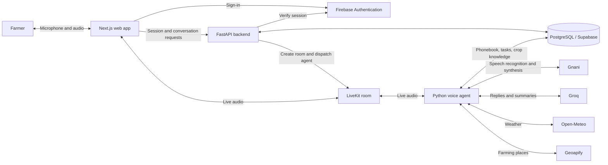

# OpenCall

## The problem

Farmers often need timely answers about crops, weather, and local supplies, but useful information can be scattered across websites, services, and language barriers. Searching through several interfaces is difficult when a question is easier to ask aloud and the answer depends on local conditions.

## The solution

OpenCall is a voice assistant for farming questions. A caller can speak with the agent, interrupt it naturally, and ask about crop health, weather, or nearby farming services. The agent uses available tools to look up information and can draw on a saved phonebook description for context in later conversations.

- **Crop guidance:** searches stored, sourced crop-knowledge records.
- **Weather:** retrieves current conditions, forecasts, and historical weather through Open-Meteo.
- **Nearby places:** searches Geoapify for farming-related shops and agriculture offices when configured. Listings do not confirm stock.
- **Requested calls:** saves a requested farming-related call to the task list. Outbound calling is not yet available.
- **Phonebook:** saves a short user description after a conversation to provide context for future sessions.

## Tech stack

| Layer | Technology |
| --- | --- |
| Web app | Next.js, React, TypeScript, Tailwind CSS, Bun |
| API | Python, FastAPI, Pydantic |
| Authentication and data | Firebase Authentication, PostgreSQL / Supabase |
| Real-time voice | LiveKit, Gnani Prisma speech recognition, Gnani Timbre speech synthesis |
| Language models | Groq |
| Agent tools | Open-Meteo, Geoapify, PostgreSQL crop knowledge |

## Architecture

## Getting started

Sign in with Google, open the conversation page, and start a voice session. For local setup, credentials, and validation, see the [backend guide](backend/README.md) and [voice agent guide](voiceagent/README.md). Use `bun install` and `bun run dev` for the frontend and local development launcher.

## LiveKit Cloud deployment

The GitHub Actions workflow in `.github/workflows/deploy-livekit.yml` tests the
backend and deploys the voice agent when relevant files are pushed to `main`.
It can also be run manually from the Actions tab on `main`. Frontend-only changes
and documentation do not trigger a voice deployment. Deployments are serialized;
the workflow waits until LiveKit reports the exact commit and a running replica.

The repository requires these GitHub Actions secrets for deployment:
`LIVEKIT_URL`, `LIVEKIT_API_KEY`, and `LIVEKIT_API_SECRET`. They authenticate
GitHub to LiveKit Cloud. Gnani, Groq, database credentials, and the database
certificate remain configured on the LiveKit agent; this workflow does not replace
them. The build context excludes local environment files and certificates.

Check the workflow run in GitHub Actions and the agent in LiveKit Cloud after a
push. A running replica confirms startup, not that a real voice conversation or
crop search has succeeded. To recover from a bad release, revert the change on
`main` and allow the workflow to deploy the revert.
