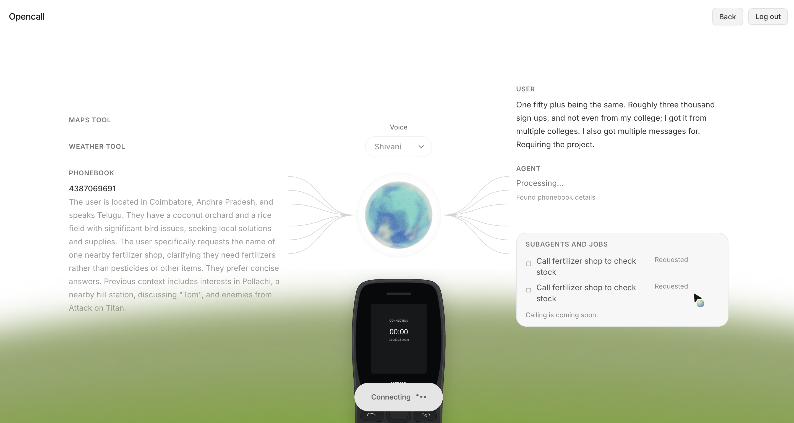
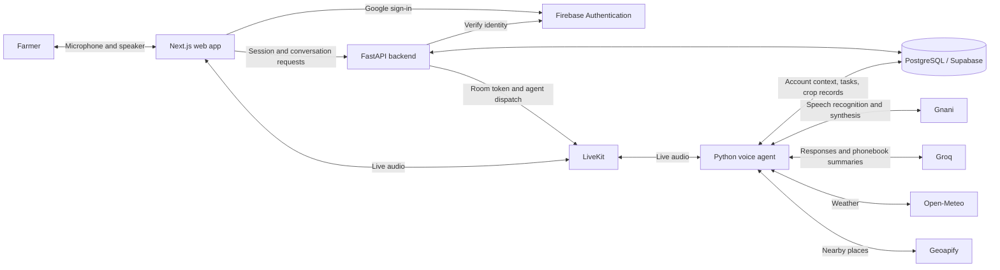

# OpenCall


OpenCall is a voice assistant for farming questions. It brings conversation, crop information, weather, nearby agricultural services, and a small amount of account context into one interface. A farmer can speak naturally, interrupt the assistant, and continue the conversation without recording and submitting each question separately. The assistant can look up relevant information as the conversation unfolds, helping users explore crop concerns, check local weather, and find agricultural services. It can also remember a short account description for future conversations and save requests for calls that may need follow-up.



## What OpenCall does

- **Continuous voice conversation:** the browser joins a LiveKit room and exchanges live audio with a Python agent. The assistant listens for turns and can be interrupted while speaking.
- **Crop guidance:** the agent searches a curated set of crop-knowledge records stored in PostgreSQL. Records include source URLs; search results are information to discuss, not a confirmed diagnosis.
- **Weather:** the agent can look up current conditions, forecasts, and historical weather through Open-Meteo, subject to the provider's coverage and the tool's supported time ranges.
- **Nearby farming services:** when Geoapify is configured, the agent can find relevant shops and agriculture offices. A listing does not establish that a product is in stock.
- **Requested calls:** the agent can save a farming-related request to the user's task list. Outbound calling and scheduling are not implemented.
- **Phonebook context:** a short description associated with the account can be edited and used to personalize later conversations. Useful details from a conversation may be merged into it when the session ends.

## How it works



1. The user signs in with Google through Firebase and completes onboarding. The frontend exchanges the Firebase token through the backend and stores an HttpOnly session cookie. The backend verifies the session and synchronizes the account with PostgreSQL.
2. When the user starts a conversation, the frontend requests connection details from the API. The API checks the account and voice service, creates a room-scoped token, and specifies the agent to dispatch. Provider credentials stay on the server.
3. The browser and agent join the LiveKit room. The worker uses speech detection and Gnani speech recognition to process the user's audio, Groq to generate a response, and Gnani speech synthesis to stream the answer back. LiveKit manages conversation turns and interruptions.
4. When useful, the model calls registered tools for crop knowledge, weather, nearby places, or requested tasks. The agent can load the user's saved phonebook description at the start and update it after the session.

The API, frontend, and voice worker are separate processes. A healthy API alone does not mean the worker is running or that external providers and browser audio are working.

## Technology

| Layer | Technology and role |
| --- | --- |
| Web app | Next.js, React, TypeScript, Tailwind CSS, and Bun |
| API | Python, FastAPI, and Pydantic |
| Identity | Firebase Authentication with Google sign-in |
| Data | PostgreSQL, including Supabase-hosted Postgres |
| Live audio | LiveKit rooms and LiveKit Agents |
| Speech | Gnani Prisma speech recognition and Timbre speech synthesis |
| Language models | Groq for conversation and phonebook summaries |
| Agent tools | Open-Meteo, Geoapify, and PostgreSQL text search |

## Repository layout

```text
opencall/
├── frontend/              Next.js pages, components, and API proxies
├── backend/
│   ├── app/               FastAPI routes, services, configuration, and agent logic
│   ├── tools/             Registered agent tools and crop-data ingestion
│   ├── migrations/        PostgreSQL schema changes
│   ├── data/              Curated crop-knowledge seed data
│   └── tests/             Backend unit and integration-boundary tests
├── voiceagent/            Worker entry point and LiveKit deployment helper
├── scripts/               Local launcher and deployment verification scripts
├── static/                README images
├── Dockerfile             LiveKit worker image
└── architecture.md        Additional architecture notes
```

## Local setup

### Prerequisites

- Bun, Python 3.11–3.13 (the backend guide uses Python 3.13), and a Python virtual environment.
- A local LiveKit server. On macOS, install it with `brew install livekit`.
- A Firebase project configured for Google sign-in, with the appropriate authorized domain and a backend service account.
- A PostgreSQL database, such as Supabase Postgres, accessible to both the API and worker.
- Gnani and Groq API keys. A Geoapify key is optional and enables nearby-place searches.

### 1. Install dependencies

From the repository root:

```bash
bun install
cd frontend
bun install
cd ../backend
python3.13 -m venv .venv-voice
source .venv-voice/bin/activate
python -m pip install -r requirements-dev.txt
cd ..
```

The combined launcher expects the Python executable at `backend/.venv-voice/bin/python`. The development requirements include both the HTTP API and voice-worker dependencies.

### 2. Configure the services

Copy the example files and edit them locally:

```bash
cp backend/.env.example backend/.env
cp frontend/.env.example frontend/.env.local
```

Set the following in `backend/.env`:

| Setting | Purpose |
| --- | --- |
| `DATABASE_URL` | Server-side PostgreSQL connection string shared by the API and worker. |
| `DATABASE_SSL_ROOT_CERT` or `DATABASE_SSL_ROOT_CERT_PEM` | Database CA certificate when required by your database connection. |
| `FIREBASE_SERVICE_ACCOUNT_PATH` or `FIREBASE_SERVICE_ACCOUNT_JSON` | Firebase Admin credentials for the API. |
| `GNANI_API_KEY`, `GROQ_API_KEY` | Speech and language-model provider credentials. |
| `GEOAPIFY_API_KEY` | Optional; enables nearby farming-place lookup. |
| `LIVEKIT_URL`, `LIVEKIT_API_KEY`, `LIVEKIT_API_SECRET` | LiveKit connection and token-signing settings. The example contains local development defaults. |
| `GROQ_MODEL`, `GROQ_SUMMARY_MODEL` | Optional model overrides for conversation and phonebook updates. |
| `CONVERSATION_MAX_SECONDS` | Maximum session duration; the example defaults to 1,800 seconds. |
| `CORS_ORIGINS` | JSON array of allowed frontend origins when they differ from the local defaults. |

`frontend/.env.local` sets the server-side `API_URL`, normally `http://127.0.0.1:8000` for local development. Never commit environment files, service-account keys, database URLs, or certificates. See the [backend configuration guide](backend/README.md) and [worker guide](voiceagent/README.md) for additional settings.

### 3. Prepare the database

Apply the SQL files in `backend/migrations/` in numeric order to the target database, including `006_optional_crop_embeddings.sql` before seeding crop records. Then, from the repository root, ingest the reviewed records:

```bash
PYTHONPATH=.:backend backend/.venv-voice/bin/python -m tools.ingest_crop_knowledge
```

The seed data and its sources are in `backend/data/crop_knowledge_seed.json`. Crop search uses PostgreSQL text search, so matches depend on the words and languages represented in the records. The API and worker must use the same database for account context and saved tasks to be available to both.

### 4. Start the app

```bash
bun run dev
```

The launcher starts or reuses the local LiveKit server, voice worker, FastAPI, and Next.js, waiting for each service to become ready. It requires the Gnani and Groq keys and forces local LiveKit settings for this development stack. Keep the terminal open; `Ctrl+C` stops the processes started by the launcher.

Open [http://localhost:3000](http://localhost:3000), sign in, complete onboarding, and open `/try`. Start a conversation and allow microphone access. The browser may also ask you to enable audio playback. The API is available at `http://127.0.0.1:8000`, with interactive documentation at `/docs`. For separate-process commands and cloud-worker setup, see the [backend guide](backend/README.md) and [voice agent guide](voiceagent/README.md).

## API overview

All API routes below use the `/api/v1` prefix. Account, conversation, and speech operations require a valid session where applicable. See `/docs` for request and response schemas.

| Endpoint | Purpose |
| --- | --- |
| `GET /health` | Process health check; it does not verify provider connectivity or a working call. |
| `POST /auth/session`, `GET /auth/me`, `POST /auth/logout` | Create, inspect, and revoke a Firebase-backed session. |
| `POST /auth/onboarding` | Complete account onboarding, with an optional phone number. |
| `POST /conversation/connect` | Obtain LiveKit connection details for an authenticated, onboarded user. |
| `GET`, `PUT /conversation/phonebook` | Read or update the account's saved description. |
| `GET /conversation/tasks` | List saved farming-related call requests. |
| `POST /speech/transcribe` | Transcribe a supported WAV recording. |
| `POST /speech/synthesize` | Generate WAV speech from text. |
| `GET /speech/voices` | List available voices for a language. |

The standalone speech endpoints are distinct from the continuous LiveKit conversation. Their audio formats, limits, and examples are documented in the [backend guide](backend/README.md). Tool behavior and limits are described in the [agent tools guide](backend/tools/README.md).

## Testing and troubleshooting

Run the backend suite and frontend checks from the repository root:

```bash
cd backend
source .venv-voice/bin/activate
python -m unittest discover -s tests -v
cd ../frontend
bun run lint
bun run build
```

Many backend tests mock provider boundaries; passing them does not establish that live credentials, microphone access, audio playback, or a deployed worker work. For an end-to-end check, sign in through the browser, start a real conversation, speak and interrupt the agent, and check the phonebook or task list as appropriate.

- **Launcher cannot start:** confirm `backend/.venv-voice` exists, provider keys are set, `livekit-server` is installed, and ports 3000, 8000, 7880, and the worker health port (8081 by default) are available. The launcher reports occupied or unhealthy services in its terminal.
- **Sign-in or account errors:** check Firebase Google sign-in, authorized domains, service-account configuration, database connectivity, and applied migrations.
- **Conversation cannot connect:** check the API and worker logs, matching LiveKit configuration, provider credentials, and browser microphone permission. The API health endpoint alone cannot validate the voice path.
- **Nearby places are unavailable:** configure `GEOAPIFY_API_KEY` for the worker and restart it. Weather and crop search have their own data and connectivity requirements.

## Deployment

The frontend and FastAPI API are hosted separately from the LiveKit voice worker. Configure the production API and worker for the same LiveKit project and database; set `VOICE_AGENT_REMOTE=true` on the production API. Supply worker provider and database secrets through LiveKit, and configure database TLS as required. The worker does not need the Firebase service-account key.

The GitHub Actions workflow in `.github/workflows/deploy-livekit.yml` runs backend tests and deploys the worker for relevant pushes to `main`; it can also run manually on `main`. It requires GitHub Actions secrets `LIVEKIT_URL`, `LIVEKIT_API_KEY`, and `LIVEKIT_API_SECRET`. Provider and database credentials remain configured on the LiveKit agent. The workflow verifies the deployed commit and a running replica, but a real authenticated browser call is still needed to validate audio and integrations. Frontend-only changes and documentation do not trigger a worker deployment.

See the [voice agent deployment guide](voiceagent/README.md) for manual deployment, worker secrets, and certificate setup. Verify the frontend, API, and worker independently after release; revert a bad change on `main` to deploy a rollback through the workflow.
