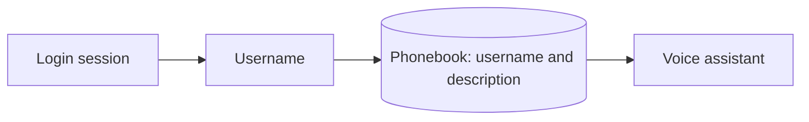

# OpenCall architecture

OpenCall has a login, a voice assistant, and a simple phonebook.
The phonebook stores a description for each username.

## Database

TinyDB stores data in `backend/data/opencall.json`.

| Table | Purpose |
| --- | --- |
| `users` | Username, display name, and password hash for login. |
| `sessions` | Login session token hash, username, and expiry. |
| `phonebook` | Username and description. |

A phonebook entry has exactly two fields:

```json
{
  "username": "demo",
  "description": "A science teacher who prefers short answers."
}
```

The username connects the login account to its phonebook entry.
An empty description is allowed.

## How it works

1. The user logs in with a username and password.
2. The backend checks the password and creates a session cookie.
3. When the user starts a conversation, the backend finds the username from that session.
4. The backend puts the username in signed LiveKit agent dispatch metadata.
5. The voice worker reads that username's description from TinyDB and gives it to the assistant.



When a session ends, the worker uses the user’s spoken messages to merge
necessary details into the existing description. This happens after the voice
session closes and may take a few seconds. The next session reads the updated
description. Only `username` and `description` are saved; spoken messages remain
in session memory and are discarded after shutdown. The description can also be
edited through the API.

## Voice flow

The browser sends microphone audio through a LiveKit room to the Python worker.
Gnani converts speech to text. Groq generates a reply, using the caller's
saved description as background context. Gnani converts the reply to audio,
which LiveKit sends back to the browser.

The frontend, FastAPI backend, LiveKit server, and Python worker run as separate
processes. Run `bun run dev` from the repository root or `frontend/` to start
all four together. The launcher waits for readiness and restarts the processes
it starts if they exit. Keep that terminal running while developing. The connect
API checks the voice services before returning room connection details.

## Read or update the description

After login, the frontend server forwards the session cookie to these backend endpoints:

| Method | FastAPI endpoint | Purpose |
| --- | --- | --- |
| GET | `/api/v1/conversation/phonebook` | Read the logged-in user's entry. |
| PUT | `/api/v1/conversation/phonebook` | Update the logged-in user's description. |

The browser uses `/api/conversation/phonebook` for both methods.
The PUT body is simply `{"description": "A science teacher."}`.
The backend takes the username from the session.

## Main files

- [auth.py](backend/app/services/auth.py): username/password login and sessions.
- [phonebook.py](backend/app/services/phonebook.py): the two-field phonebook and its storage.
- [conversation routes](backend/app/api/routes/conversation.py): authenticated connection and phonebook endpoints.
- [voice_agent.py](backend/app/voice_agent.py): reads the description, runs the assistant, and updates the description on shutdown.

See [backend setup](backend/README.md#run-locally) for startup commands and
[phonebook details](backend/phonebook.md) for the API request format.
