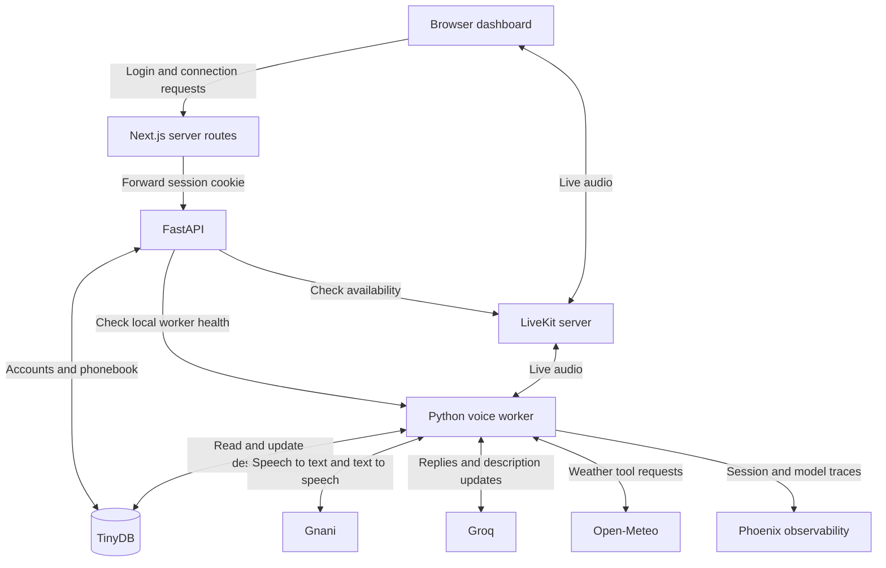

# OpenCall architecture

OpenCall connects a logged-in user to a voice assistant. A simple phonebook
stores a description for each username. The assistant reads it when a session
starts and updates it with useful details when the session ends.

## Start the app

Run this from the repository root or `frontend/`:

```bash
bun run dev
```

This runs [scripts/dev.ts](scripts/dev.ts), which starts the local services in order:

| Order | Service | Address | Responsibility |
| --- | --- | --- | --- |
| 1 | Phoenix (when enabled) | `127.0.0.1:6006` | Collects agent traces and provides the observability UI. |
| 2 | LiveKit server | `127.0.0.1:7880` | Connects the browser and voice worker through a live room. |
| 3 | Python voice worker | Health checks at `127.0.0.1:8081` | Runs the assistant and reads/updates the phonebook. |
| 4 | FastAPI backend | `127.0.0.1:8000` | Handles login, phonebook requests, and room access. |
| 5 | Next.js frontend | `localhost:3000` | Shows the dashboard, captures the microphone, and plays replies. |

The launcher waits until each service is ready before starting the next one.
It uses `backend/.venv-voice/bin/python` for the worker and API.

**Keep the launcher terminal open.** It restarts processes it started if they exit.
It reuses healthy services already running in other terminals; those services
remain managed by their original terminals. Ctrl+C stops only the processes the
launcher started. A second launcher is blocked to avoid duplicate processes.

Automatic local LiveKit startup uses `ws://127.0.0.1:7880` with the development
credentials in `backend/.env.example`. Set `GNANI_API_KEY` and `GROQ_API_KEY`
in `backend/.env`. `VOICE_WORKER_PORT` can change the worker health port.
Restart the launcher after changing worker code; the current Python worker CLI
does not reload that code automatically.

## How the parts connect



Gnani and Groq are services called by the worker. The browser and worker are the
participants in the LiveKit room.

## Database

TinyDB stores data in `backend/data/opencall.json`. This file is ignored by Git.
The API and worker use the same file; `TINYDB_PATH` can override its location.

| Table | Purpose |
| --- | --- |
| `users` | Username, display name, and password salt/hash for login. |
| `sessions` | Login session token hash, username, and expiry. |
| `phonebook` | Username and description. |

A phonebook entry has exactly two fields:

```json
{
  "username": "demo",
  "description": "A science teacher who prefers short answers."
}
```

The username connects the account to its description. An empty description is
allowed. Updates are limited to 800 characters. Database access uses a shared
file lock and atomic writes so the API and worker can safely share the local file.
There are no call records or stored transcripts in TinyDB. Phoenix stores its
observability data separately under `backend/observability/data/`.

## Login and session start

1. The user logs in. FastAPI checks the password hash and creates a login session.
2. The browser receives an HttpOnly session cookie. Sessions last 24 hours.
3. When the user starts a conversation, the frontend sends the chosen language
   and voice to `/api/conversation/connect`.
4. The Next.js server forwards the request and session cookie to FastAPI.
5. FastAPI finds the username from the session and checks voice availability.
   It contacts LiveKit using the configured credentials. For a local LiveKit
   server, it also checks the worker's health and agent name.
6. If a voice service is unavailable, the API returns `503` with a useful message.
   It does not return room connection details that the browser cannot use.
7. When the checks pass, the browser receives a signed token for a new room.
   Signed agent dispatch metadata contains the authenticated username, language,
   voice, and participant identity.
8. The browser joins the room. LiveKit dispatches the worker, which loads that
   username's description and includes it in the assistant's starting prompt.

The account comes from the login session. A username supplied in the request
body cannot select another user's profile. Description text is read directly
from TinyDB by the worker rather than placed inside the browser's token.

## During the conversation

```text
Browser microphone → LiveKit room → Python worker
                                         ↓
                              Gnani: speech to text
                                         ↓
                              Groq: generate a reply
                                         ↓
                              Gnani: text to speech
                                         ↓
Browser speakers   ← LiveKit room ← Python worker
```

LiveKit manages turn taking and interruption. Groq receives the active
conversation and the saved description as context. Spoken messages remain in
the session's memory while the conversation runs.

Restarting LiveKit or the worker interrupts an active call. The launcher can
restart its processes, but the user must start a new conversation afterward.
Restarting only FastAPI does not restart an already connected voice room.

## Agent tools

The agent's tools are registered through [backend/tools/](backend/tools/README.md).
Its first tool is `get_weather`, which accepts a city and an optional local
date, time, or range.

For a weather question, Groq selects the tool and its arguments. Python resolves
the location and requests current, forecast, or historical data from Open-Meteo.
The result goes back to Groq, which uses it to answer the user aloud. The agent
asks for a city if it does not know one and reports unsupported dates rather
than guessing weather.

Forecasts extend through 15 days after today; historical dates start in 1940.
A lookup supports up to 366 days, with compact summaries for long periods to
keep tool results small. Hour-specific requests use hourly estimates. See the
[tool documentation](backend/tools/README.md) for formats and provider limits.

Each execution appears in Phoenix as a `tool.get_weather` span of kind `TOOL`.
The tool's name, timing and error status are visible with content capture off;
arguments and results are included only when `PHOENIX_CAPTURE_CONTENT=true`.
Weather lookups do not add database tables.

## How the phonebook description updates

The update runs **after the voice session closes**, including when the user
clicks End conversation or leaves the room. It is handled by the worker's
shutdown callback, so the browser does not need to send a separate save request.

```text
Session ends
    ↓
Read the user's spoken messages from session memory
    ↓
Load the latest description for that username
    ↓
Groq merges useful details into the description
    ↓
Validate and save the updated description in TinyDB
    ↓
The next session includes it in the assistant's prompt
```

### What is sent to Groq

The worker sends two inputs: the existing description and the user's spoken
messages from the session. Assistant messages are excluded so suggestions are
not treated as facts about the user. The existing description is read again at
shutdown, rather than using only the copy loaded at session start.

The prompt asks Groq to preserve existing facts, apply explicit corrections, and
add useful identity, background, preferences, goals, and ongoing context. It
asks for no invented details, credentials, or unnecessary sensitive information.
If there is nothing useful to add, the description should stay the same.

### What is saved

Groq returns JSON containing only `description`. The backend validates the
response and its 800-character limit. A nonempty, changed description replaces
the existing value for the same username. The phonebook still has exactly two
fields: `username` and `description`.

For example, suppose the existing description is:

> A science teacher.

During the session, the user says:

> I prefer short replies in Telugu.

The saved entry could become:

```json
{
  "username": "demo",
  "description": "A science teacher who prefers short replies in Telugu."
}
```

### Timing and failed updates

Saving may take a few seconds after disconnect. To inspect the result while
logged in, request `GET /api/conversation/phonebook` through the frontend.

Empty sessions skip generation. An empty or unchanged result is not saved.
Provider errors, incomplete or invalid output, and descriptions over the limit
leave the previous value intact. If another update changes the description
while Groq is generating, this update is discarded to preserve that newer edit.
There is no background retry, and force-killing the worker can skip shutdown
saving. Model extraction can still make mistakes; PUT remains available for
manual corrections.

Spoken messages stay in session memory. No transcript, call record, or separate
summary is saved to TinyDB. Optional trace content capture is described below.

The implementation is in
[close_and_update_description](backend/app/voice_agent.py) and
[update_description_after_session](backend/app/services/phonebook.py).

## Agent observability

Phoenix shows how the agent runs: session duration, voice pipeline stages,
LLM requests, token usage, errors, and the description update after the call.
Open **http://localhost:6006** and select the **opencall** project.

The worker exports LiveKit's native spans and OpenAI-compatible Groq request
spans. A parent `opencall.session` span groups the call and description-update
spans together using the room/session ID and username. On shutdown the worker
finishes the description update, ends the parent span, and flushes traces.

All tracing code, settings, dependencies, and the local Phoenix runner live in
[backend/observability/](backend/observability/README.md). Its generated trace
database is ignored by Git and separate from the phonebook.

Tracing is enabled by default. `PHOENIX_ENABLED=false` disables it. Timing,
model/token information, outcomes and session/user labels are captured by default;
prompt and reply text are hidden. Set `PHOENIX_CAPTURE_CONTENT=true` in
`backend/.env` to store and inspect that text in Phoenix. Restart the launcher
and worker after changing these settings. This integration does not add audio recording.

## Main endpoints

| Method | FastAPI endpoint | Purpose |
| --- | --- | --- |
| POST | `/api/v1/auth/login` | Log in and set a session cookie. |
| GET | `/api/v1/auth/me` | Read the logged-in user. |
| POST | `/api/v1/auth/logout` | Revoke the session and clear the cookie. |
| POST | `/api/v1/conversation/connect` | Check services and return room connection details. |
| GET | `/api/v1/conversation/phonebook` | Read the logged-in user's phonebook entry. |
| PUT | `/api/v1/conversation/phonebook` | Edit that user's description. |

The browser uses `/api/auth/...` and `/api/conversation/...` on the Next.js server,
which forwards the session cookie to FastAPI. PUT accepts
`{"description": "A science teacher."}`; the backend supplies the username.

## Main files

| File | Responsibility |
| --- | --- |
| [scripts/dev.ts](scripts/dev.ts) | Starts services including Phoenix, waits for readiness, and restarts managed processes. |
| [observability/](backend/observability/README.md) | Phoenix collector, configuration, session spans and model instrumentation. |
| [auth.py](backend/app/services/auth.py) | Username/password login and sessions. |
| [conversation.py](backend/app/services/conversation.py) | Voice availability checks and signed room tokens. |
| [tools/](backend/tools/README.md) | Weather tool and the list of tools registered with the agent. |
| [phonebook.py](backend/app/services/phonebook.py) | Two-field phonebook storage and description generation. |
| [voice_agent.py](backend/app/voice_agent.py) | Loads the description, runs the assistant, and saves an update on shutdown. |
| [database.py](backend/app/core/database.py) | Shared file locking and atomic TinyDB writes. |

See [backend setup](backend/README.md#run-locally) for installation and manual
startup commands, and [phonebook details](backend/phonebook.md) for its API format.
