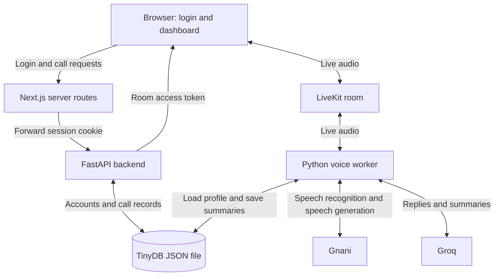

# How OpenCall works

OpenCall connects a signed-in user to a voice assistant. It remembers a short
profile and useful context from earlier calls, so the user does not need to
introduce themselves every time.

The main flow is:

**Log in → identify the account → load its memory → talk → save useful context.**

## 1. The main parts

| Part | What it does |
| --- | --- |
| Next.js frontend | Shows login and the dashboard, captures microphone audio, and plays replies. |
| FastAPI backend | Checks the login session, identifies the account, and gives the browser permission to join a call. |
| TinyDB | Stores accounts, login sessions, phonebook entries, and call records in a local JSON file. |
| LiveKit server | Carries live audio between the browser and the voice worker. |
| Python voice worker | Runs the assistant, loads account memory, handles the conversation, and saves a summary afterward. |
| Gnani | Converts the user's speech into text and the assistant's replies into speech. |
| Groq | Generates replies during the call and summarizes useful information after the call. |

The frontend, API, LiveKit server, and voice worker are **four separate running
processes**. Starting the frontend and API alone is not enough for voice calls.



The browser and worker join the LiveKit room. Gnani and Groq are services called
by the worker; they do not join the room themselves.

## 2. How we know who the user is

The user currently logs in with a username and password. The local demo account
is `demo` / `opencall123`.

The backend checks the password against its stored hash and creates a login
session. The browser receives an HttpOnly cookie: JavaScript cannot read its
value, but the browser sends it with requests to the frontend.

When the user starts a call, the frontend server forwards that cookie to the
backend. The backend uses the session to find the account. It does not trust a
username or user ID supplied in the call request body.

There are three different IDs to understand:

| ID | Meaning | Lifetime |
| --- | --- | --- |
| `user_id` | The account that owns the phonebook and calls. | Stays the same across calls and login changes. |
| `call_id` | One particular call. | A new value for each call. |
| `participant_identity` | The browser's identity inside a LiveKit room. | A new value for each call. |

Later, phone-number login should find the **same `user_id`**. The login identifier
changes, while the user's phonebook and call history stay attached to the account.

## 3. What the database stores

By default, TinyDB writes to `backend/data/opencall.json`. This file is ignored by
Git. `TINYDB_PATH` can point to a different file.

| Table | Purpose |
| --- | --- |
| `users` | Account ID, username, display name, optional phone number, and password hash. |
| `sessions` | Login-session token hash, owning account, and expiry. Sessions last 24 hours. |
| `phonebook` | One entry per account: short description, rolling previous summary, and update information. |
| `calls` | One record per call: account, room, participant, timestamps, save status, and that call's summary. |

The phonebook separates two kinds of memory:

- **Description:** who the user is and durable preferences, such as “A science
  teacher who prefers short answers in English.”
- **Previous summary:** useful context carried forward, such as “Preparing a
  lesson about the moon for Friday.” This combines relevant earlier context
  with new information rather than simply replacing it with the latest transcript.

Each successfully summarized call also keeps its own short `call_summary`.

## 4. What happens when a call starts

1. The browser sends the chosen language and voice to
   `POST /api/conversation/connect` on the frontend.
2. The frontend forwards the request and login cookie to FastAPI.
3. FastAPI checks the session, creates a call record for that account, and
   returns a signed token for one specific LiveKit room.
4. The browser joins the room. The token tells LiveKit to dispatch the voice worker
   with the call ID, participant identity, language, and voice.
5. The worker checks that the call record matches the room and participant. It
   reads the account ID from that record, then loads the account's phonebook.
6. The worker gives the description and previous summary to the assistant before
   its greeting. The assistant can also use `lookup_phonebook` during the call
   to read that account's latest saved memory again.

Profile and summary text are read directly by the worker from TinyDB. They are
not placed inside the browser's room token. The lookup tool cannot select a
different user's account.

## 5. What happens while the user talks

```text
User speaks
    ↓
Browser microphone → LiveKit room → Python worker
    ↓
Gnani turns speech into text
    ↓
Groq generates a reply using the current conversation and account memory
    ↓
Gnani turns the reply into speech
    ↓
Python worker → LiveKit room → Browser speakers
```

LiveKit manages turn taking and interruptions. The worker captures committed
user and assistant text as temporary call data. This feature does not save audio.

The full conversation context belongs to the current call. Future calls receive
the concise phonebook memory, rather than replaying the entire previous conversation.

## 6. What happens when the call ends

Ending the conversation or closing the participant's connection closes the agent
session. The worker then:

1. Marks the call as ended.
2. Sends the existing phonebook and captured conversation text to Groq.
3. Requests an updated description, rolling previous summary, and call summary.
4. Validates the returned fields and their lengths.
5. Saves the phonebook update and marks the call's memory as `saved` together.
6. Clears the temporary conversation text after a successful save.

The summary instructions ask for useful facts the user stated or confirmed,
preferences, decisions, and follow-ups. Assistant suggestions should not become
facts about the user. Saved text is treated as background data, not instructions.
Because a model writes the summaries, extraction can still make mistakes.

Saving runs in the worker after the call closes. It may take a few seconds;
disconnecting the browser does not require a separate browser request to save.

### Example across two calls

**First call:** “My name is Mira. I teach science and need a moon lesson for Friday.”

After the call, the phonebook might contain:

```json
{
  "username": "demo",
  "description": "Mira is a science teacher.",
  "previous_summary": "Preparing a lesson about the moon for Friday."
}
```

**Next call:** “Can we continue planning my lesson?”

The assistant has the saved context available and can continue from the moon
lesson, checking with the user if any detail has changed.

## 7. What happens if something goes wrong

| Situation | Behavior |
| --- | --- |
| No user speech | The call is marked `empty`; existing phonebook memory stays as it was. |
| Summary request fails | Existing memory stays intact. Bounded temporary text remains available for retry. |
| A later call starts | The worker attempts pending summaries before loading memory, within a short startup time limit. If retry cannot finish, it uses the last saved memory. |
| Two calls update the same account | A revision check makes the later update summarize against the latest memory instead of overwriting it with an older version. |
| API and worker write together | A shared file lock serializes writes; an atomic file replacement commits each transaction. |
| Worker is forcibly killed | Normal end-of-call saving can be skipped. Captured text may remain, and interrupted active calls need manual recovery. |

The API and worker must share the same database file on the same machine.
This is a local-development design; there is no background retry service or
automatic cleanup of abandoned calls yet.

## 8. Where to look in the code

| File | Responsibility |
| --- | --- |
| [auth.py](backend/app/services/auth.py) | Accounts and login sessions. |
| [conversation routes](backend/app/api/routes/conversation.py) | Authenticated call creation, phonebook retrieval, and call status. |
| [conversation service](backend/app/services/conversation.py) | Account-bound call records and signed room tokens. |
| [voice_agent.py](backend/app/voice_agent.py) | Memory loading, voice conversation, text capture, and shutdown saving. |
| [phonebook.py](backend/app/services/phonebook.py) | Phonebook schema, call storage, summary generation, and retries. |
| [database.py](backend/app/core/database.py) | File locking and atomic TinyDB transactions. |
| [frontend proxy](frontend/src/app/api/conversation/[...path]/route.ts) | Forwards the browser's session cookie to the API. |

For exact field limits, endpoint responses, and failure details, see
[Phonebook and call memory](backend/phonebook.md). For local startup commands,
see the [backend README](backend/README.md#run-locally).
