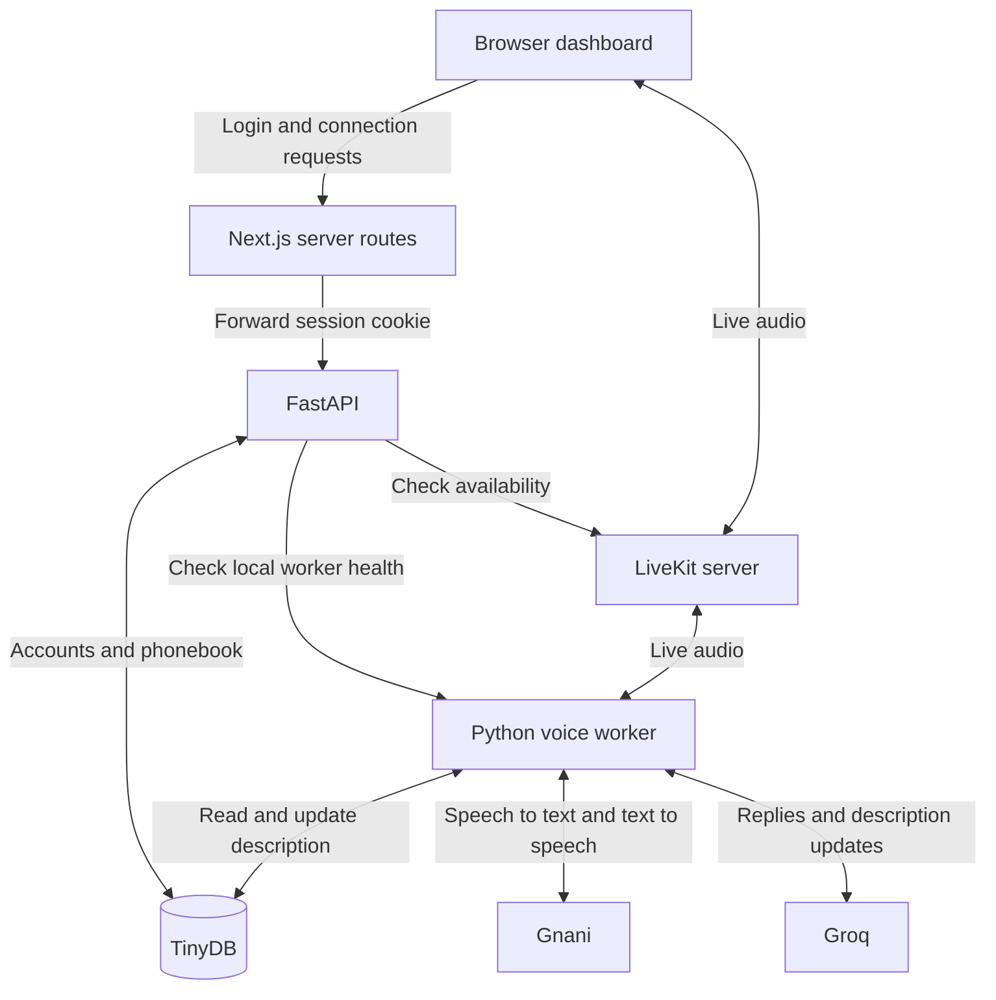

# OpenCall architecture

OpenCall connects a logged-in user to a voice assistant. A simple phonebook
stores a description for each username. The assistant reads it when a session
starts and updates it with useful details when the session ends.

## Start the app

Run this from the repository root or `frontend/`:

```bash
bun run dev
```

This runs [scripts/dev.ts](scripts/dev.ts), which starts the local services in order:

| Order | Service | Address | Responsibility |
| --- | --- | --- | --- |
| 1 | LiveKit server | `127.0.0.1:7880` | Connects the browser and voice worker through a live room. |
| 2 | Python voice worker | Health checks at `127.0.0.1:8081` | Runs the assistant and reads/updates the phonebook. |
| 3 | FastAPI backend | `127.0.0.1:8000` | Handles login, phonebook requests, and room access. |
| 4 | Next.js frontend | `localhost:3000` | Shows the dashboard, captures the microphone, and plays replies. |

The launcher waits until each service is ready before starting the next one.
It uses `backend/.venv-voice/bin/python` for the worker and API.

**Keep the launcher terminal open.** It restarts processes it started if they exit.
It reuses healthy services already running in other terminals; those services
remain managed by their original terminals. Ctrl+C stops only the processes the
launcher started. A second launcher is blocked to avoid duplicate processes.

Automatic local LiveKit startup uses `ws://127.0.0.1:7880` with the development
credentials in `backend/.env.example`. Set `GNANI_API_KEY` and `GROQ_API_KEY`
in `backend/.env`. `VOICE_WORKER_PORT` can change the worker health port.
Restart the launcher after changing worker code; the current Python worker CLI
does not reload that code automatically.

## How the parts connect



Gnani and Groq are services called by the worker. The browser and worker are the
participants in the LiveKit room.

## Database

TinyDB stores data in `backend/data/opencall.json`. This file is ignored by Git.
The API and worker use the same file; `TINYDB_PATH` can override its location.

| Table | Purpose |
| --- | --- |
| `users` | Username, display name, and password salt/hash for login. |
| `sessions` | Login session token hash, username, and expiry. |
| `phonebook` | Username and description. |

A phonebook entry has exactly two fields:

```json
{
  "username": "demo",
  "description": "A science teacher who prefers short answers."
}
```

The username connects the account to its description. An empty description is
allowed. Updates are limited to 800 characters. Database access uses a shared
file lock and atomic writes so the API and worker can safely share the local file.
There are no call records or stored transcripts.

## Login and session start

1. The user logs in. FastAPI checks the password hash and creates a login session.
2. The browser receives an HttpOnly session cookie. Sessions last 24 hours.
3. When the user starts a conversation, the frontend sends the chosen language
   and voice to `/api/conversation/connect`.
4. The Next.js server forwards the request and session cookie to FastAPI.
5. FastAPI finds the username from the session and checks voice availability.
   It contacts LiveKit using the configured credentials. For a local LiveKit
   server, it also checks the worker's health and agent name.
6. If a voice service is unavailable, the API returns `503` with a useful message.
   It does not return room connection details that the browser cannot use.
7. When the checks pass, the browser receives a signed token for a new room.
   Signed agent dispatch metadata contains the authenticated username, language,
   voice, and participant identity.
8. The browser joins the room. LiveKit dispatches the worker, which loads that
   username's description and includes it in the assistant's starting prompt.

The account comes from the login session. A username supplied in the request
body cannot select another user's profile. Description text is read directly
from TinyDB by the worker rather than placed inside the browser's token.

## During the conversation

```text
Browser microphone → LiveKit room → Python worker
                                         ↓
                              Gnani: speech to text
                                         ↓
                              Groq: generate a reply
                                         ↓
                              Gnani: text to speech
                                         ↓
Browser speakers   ← LiveKit room ← Python worker
```

LiveKit manages turn taking and interruption. Groq receives the active
conversation and the saved description as context. Spoken messages remain in
the session's memory while the conversation runs.

Restarting LiveKit or the worker interrupts an active call. The launcher can
restart its processes, but the user must start a new conversation afterward.
Restarting only FastAPI does not restart an already connected voice room.

## When the session ends

1. The worker closes the voice session and reads the user's messages from its
   in-memory conversation history.
2. It sends those messages and the latest existing description to Groq.
3. Groq merges necessary facts, preferences, goals, and ongoing context into
   one updated description. Existing facts should stay unless the user corrects them.
4. The worker validates the result and saves only `username` and `description`.
5. The next session loads that updated description into its starting prompt.

This update can take a few seconds after disconnect. Assistant messages are
excluded from the update input so suggestions are not treated as user facts.
No transcript or separate summary is written to the database.

Empty sessions skip the update. Provider errors, invalid output, or a newer
concurrent edit preserve the current description. There is no background retry.
Force-killing the worker can skip shutdown saving, and model extraction can
make mistakes. The description can also be edited through the API.

## Main endpoints

| Method | FastAPI endpoint | Purpose |
| --- | --- | --- |
| POST | `/api/v1/auth/login` | Log in and set a session cookie. |
| GET | `/api/v1/auth/me` | Read the logged-in user. |
| POST | `/api/v1/auth/logout` | Revoke the session and clear the cookie. |
| POST | `/api/v1/conversation/connect` | Check services and return room connection details. |
| GET | `/api/v1/conversation/phonebook` | Read the logged-in user's phonebook entry. |
| PUT | `/api/v1/conversation/phonebook` | Edit that user's description. |

The browser uses `/api/auth/...` and `/api/conversation/...` on the Next.js server,
which forwards the session cookie to FastAPI. PUT accepts
`{"description": "A science teacher."}`; the backend supplies the username.

## Main files

| File | Responsibility |
| --- | --- |
| [scripts/dev.ts](scripts/dev.ts) | Starts services, waits for readiness, and restarts managed processes. |
| [auth.py](backend/app/services/auth.py) | Username/password login and sessions. |
| [conversation.py](backend/app/services/conversation.py) | Voice availability checks and signed room tokens. |
| [phonebook.py](backend/app/services/phonebook.py) | Two-field phonebook storage and description generation. |
| [voice_agent.py](backend/app/voice_agent.py) | Loads the description, runs the assistant, and saves an update on shutdown. |
| [database.py](backend/app/core/database.py) | Shared file locking and atomic TinyDB writes. |

See [backend setup](backend/README.md#run-locally) for installation and manual
startup commands, and [phonebook details](backend/phonebook.md) for its API format.
