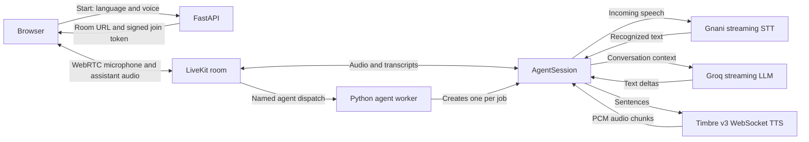

# OpenCall voice agent

This document explains the continuous voice conversation implemented in this
repository: how audio flows, how a session is created and isolated, how the agent
handles turns and interruptions, and what happens when a conversation ends.

The main entry point is `/try` after Google sign-in. Start a conversation, allow
the microphone, and speak naturally. The assistant replies aloud and can be
interrupted by speaking over it.

Implementation baseline: commit `e0d676f`, reviewed on October 22, 2026.

## 1. Architecture

Four processes participate in a local conversation. FastAPI issues connection
details; the ongoing audio conversation runs through the LiveKit room and worker.
Audio does not pass through the FastAPI HTTP endpoint on every turn.

| Component | Responsibility | Local address or entry point |
| --- | --- | --- |
| Next.js frontend | Microphone, room connection, playback, controls, transcript display | `http://localhost:3000/try` |
| FastAPI API | Validate options and sign a restricted participant token | `http://127.0.0.1:8000/api/v1/conversation/connect` |
| LiveKit server | Signaling, room membership, media routing, agent dispatch | `ws://127.0.0.1:7880` |
| Python agent worker | Run each conversation's STT, LLM, TTS, VAD, and turn handling | `PYTHONPATH=backend python -m voiceagent.worker dev` |



The LiveKit server routes media. The Python worker decides what the assistant
says. Gnani recognizes and synthesizes speech, while Groq generates the reply.

## 2. Important files

| File | What it contains |
| --- | --- |
| [`frontend/src/components/try/TryCall.tsx`](frontend/src/components/try/TryCall.tsx) | Continuous conversation UI and browser room lifecycle |
| [`backend/app/api/routes/conversation.py`](backend/app/api/routes/conversation.py) | `POST /api/v1/conversation/connect` |
| [`backend/app/services/conversation.py`](backend/app/services/conversation.py) | Request schema, token grants, room configuration, dispatch metadata |
| [`voiceagent/worker.py`](voiceagent/worker.py) | Worker registration and per-conversation `AgentSession` |
| [`backend/app/services/realtime_speech.py`](backend/app/services/realtime_speech.py) | Timbre v3 WebSocket output adapter |
| [`backend/app/core/config.py`](backend/app/core/config.py) | Environment-backed backend configuration |
| [`backend/.env.example`](backend/.env.example) | Configuration template without provider credentials |
| [`backend/tests/test_conversation.py`](backend/tests/test_conversation.py) | Token restrictions and streaming audio tests |
| [`backend/tests/test_voice_agent.py`](backend/tests/test_voice_agent.py) | Worker initialization and interruption configuration tests |

## 3. What happens when you start

```mermaid
sequenceDiagram
    actor User
    participant UI as Browser
    participant API as FastAPI
    participant LK as LiveKit server
    participant Worker as Agent worker
    participant Session as AgentSession
    User->>UI: Select language and voice; Start
    UI->>API: POST /conversation/connect
    API->>API: Validate options; generate room and identity
    API-->>UI: Server URL and signed participant token
    UI->>LK: Connect with token
    LK->>Worker: Dispatch opencall-conversation job
    Worker->>Worker: Validate dispatch metadata; construct providers
    Worker->>LK: Connect and wait for intended participant
    Worker->>Session: Start room audio and conversation agent
    UI->>LK: Publish microphone track
    Session-->>LK: Greeting audio and transcription
    LK-->>UI: Assistant audio and transcription
    UI-->>User: Play greeting; show conversation state
```

The exact ordering of microphone publication and worker initialization can vary:
they happen asynchronously after the browser joins. The worker explicitly connects
to the room before starting `RoomIO`, then waits for the participant identity
specified by the token's dispatch metadata.

The API does not call a room-creation service or allocate a Python session when it
signs a token. The token carries the room configuration; joining LiveKit triggers
the room/dispatch behavior. A successful token response alone does not prove that
LiveKit, the worker, or either speech provider is reachable.

## 4. Session ownership and isolation

There are several related objects, each with a different lifetime.

| Object | Created by | Scope and lifetime |
| --- | --- | --- |
| Participant token | FastAPI | A bearer credential allowing entry into one named room; 10-minute join validity |
| LiveKit room | LiveKit, when joined using the supplied configuration | One conversation's media and participants |
| Browser `Room` | Frontend `start()` | One connection attempt; disconnected when ended, cancelled, or unmounted |
| Agent job / `JobContext` | LiveKit worker infrastructure | The dispatched conversation job |
| `AgentSession` | `conversation(ctx)` in the worker | One job's conversation, context, providers, and turn handling |
| TTS WebSocket | `_AudioStream._run()` | One synthesis stream, normally a sentence produced by LiveKit's adapter |

### Unique rooms and identities

Every successful connection request generates:

```text
room_name:             opencall-<random UUID hex>
participant_identity:  user-<random UUID hex>
agent_name:            opencall-conversation
```

The room is configured for at most two participants: the user and assistant.
The dispatch includes the chosen `language_code`, `voice`, and intended
`participant_identity`. `RoomOptions` binds the worker's audio input to that
identity.

Opening another tab and starting a conversation creates another room and job.
There is no global shared chat history or shared provider instance between these
application sessions. Each worker entrypoint constructs its own STT, LLM, TTS,
VAD, and `AgentSession` objects. The SDK manages worker processes; the application
does not assume a permanently dedicated operating-system process for each user.

### Where conversation history lives

LiveKit's `AgentSession` manages the active chat context and feeds it to the LLM.
This lets later turns refer to earlier conversation in the same running session.
The application stores phonebook descriptions in Supabase Postgres. The API exposes
`username` and `description`. The login session identifies the username, which
is passed to the worker in signed agent dispatch metadata. The worker loads that
username's description before starting the assistant.

At session end, the worker merges necessary details from the user’s spoken
messages into the existing description using Groq. Only the description is saved;
there are no stored call records, transcripts, or separate summaries. Empty
sessions and failed updates preserve the description. Explicit edits are also
available through the phonebook API.
See [Phonebook](backend/phonebook.md) for its schema and endpoints.

### Token lifetime versus conversation lifetime

The token is valid for joining for **10 minutes**. That expiry is not the active
call's duration limit. The worker separately schedules a shutdown after
`CONVERSATION_MAX_SECONDS`, which defaults to **1,800 seconds / 30 minutes**.
Its timer starts during job initialization, before room connection/session startup.

The JWT is room-scoped and grants microphone publication, subscription, and data
publication. It does not grant room administration or room-listing access. The API
returns it with `Cache-Control: no-store`. Treat it as a credential: the current
application does not implement one-time token consumption or an application-level
revocation service.

## 5. One complete conversational turn

1. The microphone remains enabled while connected, unless you mute it.
2. The browser publishes audio into the LiveKit room. Capture requests echo
   cancellation, noise suppression, and automatic gain control.
3. The worker receives mono audio at **16 kHz** and sends it to Gnani's streaming
   STT provider using `use_streaming=True`.
4. Silero VAD detects speech activity and silence. LiveKit combines this with
   transcription and endpointing rules to commit a user turn.
5. The recognized text and active conversation context go to Groq.
6. Groq produces text incrementally. LiveKit's sentence adapter passes available
   sentences to the TTS provider.
7. Timbre v3 produces audio chunks over WebSocket. The adapter pushes PCM into
   LiveKit's audio emitter as chunks arrive.
8. LiveKit sends audio to the browser, and `RoomAudioRenderer` plays it. The
   conversation transcript is updated through LiveKit's transcription streams.
9. The session returns to listening and continues without another button click.

The worker instructs the assistant to use the selected language, keep responses
brief, avoid Markdown, and respond to the newest request after interruption.
Groq generation has `max_completion_tokens=512`. No tools, retrieval system,
database access, or specialist agents are attached to this assistant.

## 6. Turn detection and interruptions

The current worker configures these values explicitly:

| Setting | Value | Purpose |
| --- | --- | --- |
| Silero `min_silence_duration` | `0.35` seconds | Speech activity detection's silence threshold |
| `turn_detection` | `vad` | Use voice activity detection for turn handling |
| Endpointing minimum delay | `0.5` seconds | Allow a short pause before completing a turn |
| Endpointing maximum delay | `3.0` seconds | Upper configured endpointing delay |
| Interruptions enabled | `True` | Allow the user to take the turn during assistant speech |
| Interruption mode | `vad` | Detect interruptions from speech activity |
| Minimum interruption duration | `0.35` seconds | Require sustained speech instead of reacting to every small sound |
| Minimum interruption words | `0` | Do not require a recognized word before interrupting |
| Resume false interruption | `True` | Let LiveKit resume when an interruption is classified as false |

These are detection settings, not guarantees of a precise end-to-end response
latency. Transcription arrival, provider latency, network conditions, audio
buffering, and SDK behavior also affect when a reply starts or stops. The current
implementation uses VAD-based detection; it does not add a semantic turn detector
or an adaptive interruption model.

When you speak during a reply, LiveKit detects the interruption, stops the
assistant's outgoing playback, and manages cancellation of its speech pipeline.
The TTS stream owns its socket inside an asynchronous context manager, so stream
cancellation exits that context and closes the socket. LiveKit manages the
conversation context associated with interrupted speech; this repository does
not implement its own word-by-word history truncation algorithm.

A typical successful interruption follows this sequence:

```text
Assistant speaking
    → user begins sustained speech
    → assistant yields / stops playback
    → session listens to the new input
    → new user turn is committed
    → assistant thinks and streams the next reply
```

The SDK can temporarily suppress interruptions during acoustic echo-cancellation
warmup. In the local live test, its logs showed a three-second warmup around the
first assistant audio. This is SDK behavior, not an application timeout.

Background speech or speaker echo can still trigger interruptions. Headphones
help. A pause in the middle of a thought can also cause early endpointing; tune
these settings with representative real conversations rather than treating them
as universally optimal.

## 7. What “streaming” means in this implementation

There are three streaming boundaries:

| Boundary | Behavior |
| --- | --- |
| User audio → STT | Gnani receives ongoing speech through its streaming plugin |
| LLM → TTS adapter | Groq text arrives incrementally; LiveKit groups text into sentences |
| TTS → room | Gnani audio arrives in chunks and is forwarded without collecting a full reply WAV |

`ConversationTTS` advertises `TTSCapabilities(streaming=False)`. In this interface,
that flag means it does not accept a continuous stream of text tokens directly.
LiveKit therefore wraps it in a sentence adapter. Its `synthesize(text)` still
returns a `ChunkedStream` that streams **audio**. The flag does not mean the
browser waits for the complete reply before hearing anything.

For each synthesis stream, the custom adapter:

1. Opens `wss://api.vachana.ai/api/v1/tts` with the backend-only Gnani key.
2. Sends the sentence, selected voice and language, `model="timbre-v3.0"`, and
   a raw linear PCM output configuration.
3. Reads binary audio or base64 audio inside JSON messages.
4. Preserves incomplete 16-bit samples between chunks so arbitrary network chunk
   boundaries do not corrupt the audio.
5. Emits mono **24 kHz, 16-bit PCM** with a requested emitter frame size of **20 ms**.
   LiveKit may reframe audio or emit a short final marker internally.
6. Requires a completion message and rejects a stream ending with an incomplete sample.
7. Closes the socket on success, error, timeout, or cancellation.

Socket opening has a 10-second timeout and closing has a three-second timeout.
The whole stream is also bounded by the `APIConnectOptions.timeout` supplied by
LiveKit. The application does not keep one permanent TTS socket for the entire
conversation, and it does not implement a separate application retry queue.

The explicit adapter preserves Timbre v3's language field and raw PCM streaming
contract. The earlier recording/playback endpoints use a different adapter in
`backend/app/services/livekit_gnani.py`; they return completed WAV responses.

## 8. Browser state, controls, and cleanup

The frontend keeps the active room in both React state and a ref. A `busy` ref
blocks duplicate starts. A monotonically increasing `generation` identifies each
attempt, preventing stale async work from an ended attempt from becoming active.

| Action or event | Result |
| --- | --- |
| Start | Request connection details, connect to LiveKit, enable microphone and audio |
| Change language/voice | Allowed before a session; selectors are locked during connection and conversation |
| Mute | Disable microphone publication while remaining connected and able to hear the assistant |
| Unmute | Re-enable the microphone in the same session |
| Enable audio | Retry browser audio playback if autoplay is blocked |
| End | Invalidate pending work, abort a pending API request, disconnect the room, clear active UI |
| Cancel while connecting | Invalidate the connection attempt and disconnect if a room already exists |
| Page unmount/navigation | Invalidate work, abort the request, and disconnect the active room |
| Final room disconnect | Clear active state and allow starting a fresh conversation |
| Assistant participant leaves | End the local session and show a reconnect message |

A 15-second `AbortController` timer bounds the connection-details HTTP request.
It is not a universal timeout for microphone permission or the whole WebRTC call.
If cancellation happens while microphone enabling is pending, the code checks the
attempt generation afterward and disables the microphone/disconnects the stale room.

`useConnectionState()` displays reconnecting states while the SDK attempts
recovery. The application does not issue a new token automatically or recreate
chat history after a final disconnect. A new **Start conversation** creates a new
room, rather than resuming an earlier session.

`useVoiceAssistant()` drives listening, thinking, and speaking labels.
`useTranscriptions()` supplies transcript text, and participant identity decides
whether a message is labeled **You** or **OpenCall**. Messages are held in the
mounted UI, not saved in local storage or a backend transcript database. Ending
the session unmounts that conversation component and clears its visible messages.

If no agent has appeared after 30 seconds, the UI displays a worker-availability
message. That message does not automatically disconnect the microphone; the user
can end the session. Microphone and playback errors also have visible recovery
messages.

## 9. Worker shutdown and resource lifetime

The worker registers `session.aclose` as a job shutdown callback. It also creates
a duration-limit task and registers another callback that cancels and awaits
that task during shutdown.

| Exit condition | Handling |
| --- | --- |
| Intended participant disconnects | `close_on_disconnect=True` lets LiveKit close the linked session |
| Duration limit reached | Call `session.shutdown()` and `ctx.shutdown()` |
| Unrecoverable provider error | Log a generic failure, shut down the session and job |
| Worker/job shutdown | Run registered callbacks to close the session and cancel the duration task |
| TTS stream cancellation | Exit the stream's WebSocket context |

Room configuration uses `empty_timeout=60` and `departure_timeout=20` seconds.
These are LiveKit room cleanup settings, separate from the worker's active-call
limit. The application does not explicitly delete the room through a REST call
when the browser clicks End. It relies on disconnect handling and server room
lifecycle rules.

The current implementation creates provider and VAD objects per job. It does not
prewarm Silero in application code or maintain its own provider connection pool.
Recoverable SDK/provider errors are handled by the SDK's policy; the worker's
explicit error hook closes the job only when `recoverable` is false.

## 10. HTTP contract

### Request

```http
POST /api/v1/conversation/connect
Content-Type: application/json
```

```json
{
  "language_code": "en-IN",
  "voice": "Shivani"
}
```

Both fields are optional. The defaults are `en-IN` and `Shivani`.

### Response

```json
{
  "server_url": "ws://127.0.0.1:7880",
  "participant_token": "<signed JWT; treat as a credential>",
  "room_name": "opencall-<random UUID hex>",
  "participant_identity": "user-<random UUID hex>"
}
```

| Status | Meaning |
| --- | --- |
| `200` | Connection details signed successfully; does not establish media connectivity |
| `422` | Invalid language, unsupported voice, or invalid request fields |
| `503` | Required provider or LiveKit configuration is missing |

Available language codes: `en-IN`, `hi-IN`, `te-IN`, `ta-IN`, `kn-IN`, `ml-IN`,
`mr-IN`, `gu-IN`, `bn-IN`, and `pa-IN`.

Available v3 voices: Shivani, Avinash, Lakshmi, Kalpana, Chetana, Vasudha, Riyaa,
Tarika, Shubham, Prakash, Devansh, Yashraj, and Harshad.

The UI currently duplicates the voice/language catalog as local constants. The
backend remains authoritative for connection request validation. If the catalog
changes, update both locations. The continuous UI does not expose the recording
studio's delivery-tag selector.

## 11. Configuration

Backend settings load from `backend/.env`, with environment variables taking
precedence. Settings are cached; restart the API and worker after changes.
Provider secrets stay on the backend.

| Variable | Default | Purpose |
| --- | --- | --- |
| `GNANI_API_KEY` | Unset | Gnani recognition and speech synthesis |
| `GROQ_API_KEY` | Unset | Groq reply generation |
| `GROQ_MODEL` | `openai/gpt-oss-20b` | Live conversation model |
| `GROQ_SUMMARY_MODEL` | `qwen/qwen3.8-27b` | Separate phonebook summary model |
| `LIVEKIT_URL` | `ws://127.0.0.1:7880` | Room server used by API connection details and worker |
| `LIVEKIT_API_KEY` | `devkey` | Local development token-signing/worker identity |
| `LIVEKIT_API_SECRET` | `secret` | Local development signing secret |
| `CONVERSATION_MAX_SECONDS` | `1800` | Worker duration limit |
| `CORS_ORIGINS` | Localhost and `127.0.0.1` on port 3000 | Allowed frontend origins for FastAPI |
| `NEXT_PUBLIC_API_URL` | `http://127.0.0.1:8000` | Browser API address; configure in the frontend environment |

The LiveKit development credentials above are public loopback-server defaults,
not production credentials. For Cloud or a remote deployment, use that project's
URL/key/secret, configure API and worker consistently, and ensure `LIVEKIT_URL`
is reachable from the browser as well as the worker. A remote browser cannot use
another machine's `127.0.0.1`. HTTPS deployment also needs an appropriate secure
LiveKit connection such as `wss://...`.

`openai.LLM` here is the LiveKit OpenAI-compatible adapter pointed explicitly at
`https://api.groq.com/openai/v1`; the configured LLM requests go to **Groq**.
An `OPENAI_API_KEY` is not required for this configuration. Model availability
must match the Groq account. The selected default was verified available during
the implementation's live check.

## 12. Local setup

Use Python **3.13** for the tested setup. The existing Python 3.14 environment
could not install Silero's ONNX Runtime dependency on this machine. The separate
`.venv-voice` environment avoids modifying that older environment.

From the repository root:

```bash
python3.13 -m venv backend/.venv-voice
backend/.venv-voice/bin/python -m pip install -r backend/requirements-dev.txt
```

Create `backend/.env` from the template if it does not already exist, then set
`GNANI_API_KEY` and `GROQ_API_KEY` locally. Preserve existing credentials when
editing an existing `.env`; do not overwrite it with the example.

Run these four processes in separate terminals.

### Terminal 1: LiveKit room server

```bash
brew install livekit
livekit-server --dev --bind 127.0.0.1
```

Skip installation if LiveKit is already installed.

### Terminal 2: FastAPI

```bash
cd backend
source .venv-voice/bin/activate
python -m uvicorn app.main:app --reload --host 127.0.0.1 --port 8000
```

### Terminal 3: Voice worker

```bash
cd backend
source .venv-voice/bin/activate
python -m app.voice_agent dev
```

The pinned SDK still accepts this command but emits a deprecation notice for
its `dev` mode. It also states that Python CLI hot reload has been removed.
Restart this worker after changing its code; do not assume FastAPI's reload flag
restarts it.

### Terminal 4: Frontend

```bash
cd frontend
bun install
bun run dev
```

Open `http://localhost:3000/try`. Use localhost or HTTPS for browser
microphone access. Allow microphone permission and use **Enable audio** if the
browser blocks playback.

## 13. Troubleshooting

| Symptom | Check |
| --- | --- |
| Cannot reach the speech backend | FastAPI on port 8000, frontend API URL, CORS origins |
| Connection-details request returns `503` | Backend `.env` and required provider credentials |
| Token succeeds but room connection fails | LiveKit process, reachable URL, matching signing credentials |
| Room connects but assistant never joins | Worker process and registration as `opencall-conversation`; inspect worker logs |
| Assistant leaves immediately | Worker traceback, provider credentials, Groq model availability |
| Browser refuses microphone | Localhost/HTTPS, browser permission, device availability |
| Assistant appears to speak but no sound | Browser autoplay, Enable audio, output device, remote audio subscription |
| Agent interrupts itself | Headphones, echo cancellation, speaker volume, nearby speech/noise |
| Replies start before you finish a thought | VAD and endpointing configuration; test longer natural pauses |
| Too many or too few interruptions | Interruption minimum duration, microphone quality, noise environment |
| New conversation forgets the previous one | Expected: no persistent conversation history or resume API exists |
| Changes to settings seem ignored | Restart both API and voice worker; settings are cached |
| Silero dependency installation fails on Python 3.14 | Use the tested Python 3.13 `.venv-voice` environment |

The API health endpoint only establishes that FastAPI is responding. It does not
check worker registration, LiveKit connectivity, provider availability, or audio.

## 14. Data handling and deployment limits

The application does not currently persist audio recordings, transcripts, or
conversation history for continuous sessions. Audio and recognized text are still
processed by external providers: Gnani receives speech/synthesis requests and
Groq receives conversation text. LiveKit routes room media. Worker/SDK debug logs
can include transcript content; lack of a transcript database does not mean no
text can appear in logs. Configure logging and provider retention deliberately
for a deployment.

The token endpoint currently has no user authentication, per-user rate limit,
quota, or billing controls. There is no durable session registry, multi-device
resume, application token revocation, or persistent user memory. Random room
names and room-scoped JWTs isolate conversations, but they do not authenticate
who is allowed to create paid provider traffic.

For a public deployment, add access controls and usage limits around token
issuance, use real LiveKit credentials and secure URLs, and operate the worker as
a separate service. The present local setup is a prototype; its fixed response
length and turn thresholds have not been tuned across all supported languages
or noisy devices.

## 15. Validation and its boundaries

The implementation session recorded the following checks:

| Check | Result |
| --- | --- |
| Backend unit/transport/worker tests in Python 3.13 | 33 passed |
| Clean environment `pip check` | Passed |
| Frontend ESLint and TypeScript | Passed |
| Running `/api/v1/conversation/connect` | HTTP 200 with expected connection details |
| Live Gnani WebSocket synthesis | Successful 24 kHz audio |
| Live synthetic-audio room conversation | Worker dispatched; Gnani transcription, Groq reply, and room audio received |
| Live synthetic interruption | Speech published during a reply changed speaking → listening → thinking → speaking |
| Actual browser microphone, autoplay, and speaker echo | Not verified |
| Rendered visual inspection | Not verified; no browser automation surface was available |
| Production build | Incomplete: Turbopack/Tailwind loader hit a local port-binding permission error |

The live room test used generated speech rather than a human microphone. It
establishes that the provider/room pipeline and interruption handling worked in
that local test; it does not establish perceived latency or conversation quality
on every browser, language, device, or deployment. These are recorded results
from implementation, not a claim that the services are currently running.

To repeat the automated checks:

```bash
cd backend
.venv-voice/bin/python -m pip check
.venv-voice/bin/python -m unittest discover -s tests -v
```

```bash
cd frontend
bun run lint
bunx tsc --noEmit
```

The earlier recording endpoints have their own WAV validation and HTTP response
tests. They remain useful alongside the conversation tests but do not by themselves
verify continuous audio or interruptions.
